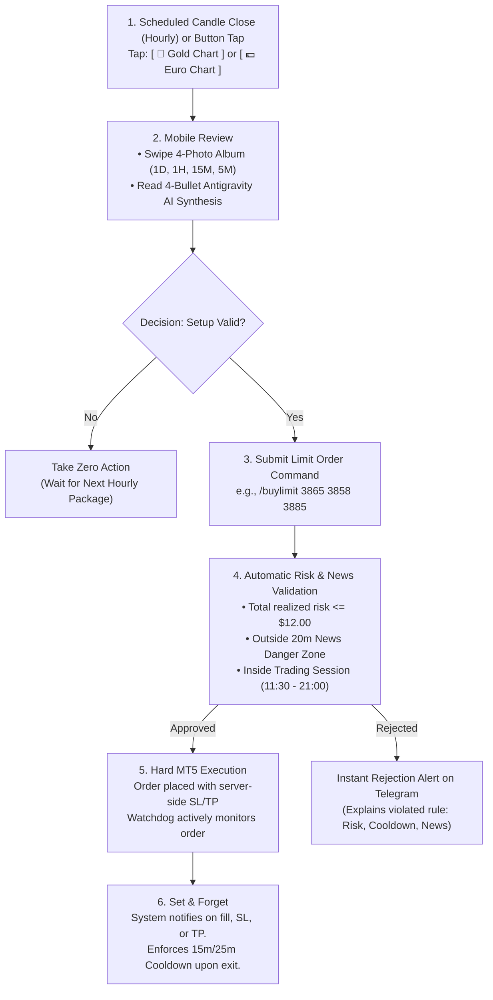
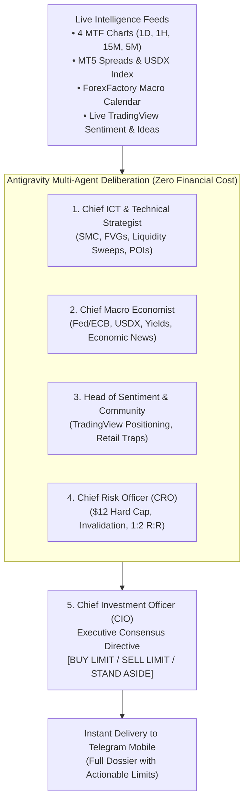
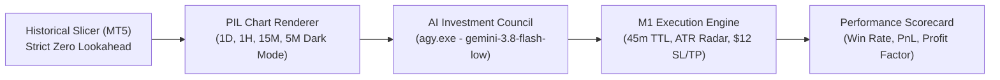

# 📱 TradingGuard HITL: Operator's Field Guide

> **Core Philosophy**: A disciplined, semi-automated Human-In-The-Loop (HITL) execution system designed for a trader with a full-time job. You analyze the charts and make the strategic decision from your mobile phone; TradingGuard handles background multi-timeframe chart captures, enforces non-negotiable risk limits, executes orders mechanically on MetaTrader 5, and guards against sharp spikes and emotional mistakes.

---

## 1. Daily Mobile Workflow (At Your Workplace)



---

## 2. Telegram Bot Command Reference

### Persistent Mobile Keyboard Buttons
| Button | Action | Details |
| :--- | :--- | :--- |
| **`[ 🥇 پکیج کامل طلا (چارت + شورا) ]`** | Gold Full Dossier | Captures 1D, 1H, 15M, and 5M TradingView charts and automatically convenes the 5-member AI Investment Council. |
| **`[ 💶 پکیج کامل یورو (چارت + شورا) ]`** | Euro Full Dossier | Captures 1D, 1H, 15M, and 5M TradingView charts for EURUSD and convenes the AI Investment Council. |
| **`[ 🏛️ فقط شورای طلا ]`** | Quick Gold Council | Convenes the 5-member Investment Council instantly on existing charts without recapturing browser tabs. |
| **`[ 🏛️ فقط شورای یورو ]`** | Quick Euro Council | Convenes the 5-member Investment Council instantly on EURUSD without recapturing browser tabs. |
| **`[ 📋 اردرهای معلق ]`** | View Pending Orders | Lists all active limit orders on MT5 with interactive `[ ❌ لغو اردر ]` buttons. |
| **`[ 📊 پوزیشن‌های باز ]`** | View Open Positions | Displays live floating PnL, open prices, SL, and TP of all filled trades. |
| **`[ 🛡️ وضعیت حساب ]`** | System & Risk Status | Reports MT5 balance, equity, daily PnL, Cooldown timer, Session status, and Circuit Breaker state. |
| **`[ ❓ راهنمای اردرها ]`** | Command Help | Displays the quick command cheatsheet and order formatting guidelines. |

---

### Text & Slash Commands

#### 1. Placing Limit Orders
- **Positional Format (Fastest)**:
  - `/buylimit <entry> <sl> <tp>` (Default symbol: Gold `XAUUSD_o`)
  - `/selllimit <entry> <sl> <tp>`
  - *Example:* `/buylimit 3865 3858 3885`
- **Explicit Symbol Format**:
  - `/buylimit BTCUSD 55000 54500 68000`
  - `/selllimit EURUSD 1.0850 1.0875 1.0790`
- **Natural Language Format**:
  - `Buy Limit 3865 SL=3858 TP=3885`
  - `Sell Limit 3892 SL=3898 TP=3870`

#### 2. Order Cancellation
- `/cancel <ticket>`: Prompts a safe two-step confirmation dialog (`[ ✅ Yes, Cancel ]` vs `[ 🔙 Keep Active ]`) to eliminate accidental mobile taps.

#### 3. Health, Diagnostics & Fundamentals
- `/ping` or `/health`: Sends an instant system health card confirming home PC uptime, MT5 connection status, and v2rayN proxy stability.
- `/news`: Displays the upcoming 24-hour high and medium-impact economic calendar events in Tehran local time (UTC+3:30).

---

## 3. The 6 Non-Negotiable Guardrails

| Guardrail | Threshold / Parameter | Behavior When Triggered |
| :--- | :--- | :--- |
| **1. Strict Risk Ceiling** | **$\le \$12.00$** per trade (including spread + commission buffer) | System calculates $\text{Price Risk} + \text{Spread Cost} + \text{Commission Buffer}$. If total risk exceeds $\$12.00$, the order is rejected immediately. |
| **2. Sharp Momentum Radar** | Adverse candle $> 2.0\times\text{ATR}$ or Spread $> 50$ points | The 3-second watchdog monitors M1 candles. If a sharp spike surges directly into your pending limit order, TradingGuard cancels the order instantly on MT5. |
| **3. Inactivity TTL Reminder** | **45 Minutes** pending without fill | Prompts you on Telegram with `[ ❌ Cancel Order ]` and `[ 👁 Keep Active ]` so stale orders don't linger forgotten. |
| **4. Post-Trade Cooldown** | **15m** after profit / **25m** after stop loss | Locks new order entries after a position closes. Eliminates emotional revenge trading and hasty re-entries. |
| **5. Daily Loss Circuit Breaker** | **$\$24.00$** daily loss OR **2 consecutive losses** | Hard lockdown. Rejects all new order commands for the remainder of the trading day. |
| **6. News Proximity Guard** | **20 minutes** before / **5 minutes** after Red news | Blocks new order entries during high-impact USD events (FOMC, CPI, NFP) to prevent spread widening and extreme slippage. Warns on active orders 15m prior. |

---

## 4. Antigravity AI Investment Council (Unified Institutional Engine)

The previous basic 4-bullet AI copilot has been fully integrated into the **Antigravity AI Investment Council**. Whenever a full chart package is requested or auto-dispatched, TradingGuard captures the 4 timeframes (`1D`, `1H`, `15M`, `5M`) and immediately convenes the 5-member investment committee simulating an institutional proprietary trading firm.



### The 5 Institutional Personas:
1. **👨‍💻 Chief ICT & Technical Strategist**:
   - Assesses 1D macro order flow and institutional intent across the 4 captured charts.
   - Identifies high-probability Buy-Side Liquidity (BSL) and Sell-Side Liquidity (SSL) pools.
   - Detects hourly Fair Value Gaps (FVGs), order blocks, and 15M/5M session manipulation (Judas Swings).
2. **🌐 Chief Macro & Geopolitical Economist**:
   - Analyzes central bank policy (Fed/ECB interest rate path) and US Dollar Index (`USDX`) strength.
   - Evaluates scheduled high/medium impact calendar releases and volatility window dangers.
3. **👥 Head of Market Sentiment & Community Intelligence**:
   - Conducts continuous reconnaissance on public TradingView community ideas and retail positioning.
   - Identifies retail sentiment traps (e.g. crowd buying at premium resistance) and uncovers liquidity targets for institutional market makers.
4. **🛡️ Chief Risk Officer (CRO)**:
   - Defends capital mathematically: enforces the non-negotiable **$12.00 max risk per trade**.
   - Verifies broker spread and commission buffers.
   - Ensures Stop Loss is positioned at objective structural market invalidation (not arbitrary points).
   - Enforces a minimum **1:2.0 Risk-to-Reward ratio**.
5. **⚖️ Chief Investment Officer (CIO)**:
   - Synthesizes the debate across technicals, macro, sentiment, and risk.
   - Issues the binding **Council Decision**: `[BUY LIMIT]`, `[SELL LIMIT]`, or `[STAND ASIDE]`.
   - If actionable, specifies exact Entry, SL, TP, and lot size.

---

## 5. Backtesting the AI Investment Council

TradingGuard features a native, zero-cost, event-driven walk-forward backtester built specifically to stress-test the **AI Investment Council's** visual perception, ICT setup selection, and CIO consensus decisions.



### Key Capabilities:
- **Strict Zero Lookahead**: Slices historical bars exactly at milestone timestamp $T$.
- **High-Fidelity Rendering**: Programmatically draws dark-mode TradingView-style candlestick PNGs directly from MT5 rates.
- **Real Microstructure Simulation**:
  - Replays forward M1 bars minute-by-minute.
  - Automatically cancels orders if unfilled after 45 minutes (Inactivity TTL).
  - Automatically cancels orders if a sharp adverse candle ($> 2.0\times\text{ATR}$) surges into entry before fill (Watchdog Radar).
  - Strictly caps risk at $\$12.00$ per trade.

### How to Run a Backtest:
```powershell
# Run a quick 5-session pilot walk-forward backtest on Gold
python hitl/backtest/run_backtest.py

# Or import in Python and run custom date ranges:
python -c "from hitl.backtest.run_backtest import run_council_backtest; run_council_backtest('XAUUSD', max_sessions=10)"
```

---

## 6. System Maintenance & PC Lifecycle

- **Automatic Startup on Boot**:
  - The silent launcher is registered in `C:\Users\Javad\AppData\Roaming\Microsoft\Windows\Start Menu\Programs\Startup\TradingGuard_AutoStart.vbs`.
  - When your PC turns on, it waits 10 seconds (giving your network and v2rayN proxy time to connect) and launches TradingGuard in the background automatically.
- **Manual Launch**:
  - Double-click [`start_tradingguard.bat`](file:///g:/Code/TradingGuard/start_tradingguard.bat) to launch with a visible diagnostic console.
  - Double-click [`start_silent.vbs`](file:///g:/Code/TradingGuard/start_silent.vbs) to launch completely hidden.
- **Stopping the Service**:
  - Double-click [`stop_tradingguard.bat`](file:///g:/Code/TradingGuard/stop_tradingguard.bat) to kill all running instances cleanly.

---

## 7. Institutional Session Clock & Seasonal DST Reference

> [!IMPORTANT]
> **Tehran abolished Daylight Saving Time (DST) permanently in 2023 (Farvardin 1402).**
> Tehran is permanently fixed at **UTC+3:30** all year round.
> However, **London (UK)** and **New York (US)** continue to observe DST, causing their local open hours to shift relative to Tehran time twice a year.

### Seasonal Schedule Comparison Table

| Session | Market Local Time | Summer (BST / EDT) — Tehran Time | Winter (GMT / EST) — Tehran Time | Note |
| :--- | :---: | :---: | :---: | :--- |
| **London Pre-Open** | 07:00 / 07:30 Local | 09:30 / 10:00 Tehran | **10:30 / 11:00 Tehran** | Pre-session (rested/banned) |
| **London Open** | 08:00 Local | 10:30 Tehran | **11:30 Tehran** | Frankfurt/London volume open |
| **London Post-Open** | 08:30 / 09:00 Local | 11:00 / 11:30 Tehran | **12:00 / 12:30 Tehran** | Prime London displacement |
| **NY Pre-Open** | 07:00 / 07:30 Local | 14:30 / 15:00 Tehran | **15:30 / 16:00 Tehran** | Pre-session (rested/banned) |
| **NY Forex Open** | 08:00 Local | 15:30 Tehran | **16:30 Tehran** | US macro liquidity arrival |
| **NYSE Equities Open** | 09:30 Local | 17:00 Tehran | **18:00 Tehran** | US Cash Equity open |
| **NY Silver Bullet** | 10:00 – 11:00 Local | 17:30 – 18:30 Tehran | **18:30 – 19:30 Tehran** | Prime Silver Bullet window |

### Transition Windows:
* **Summer Schedule**: From last Sunday of March until last Sunday of October (UK) / first Sunday of November (US).
* **Winter Schedule**: From last Sunday of October (UK) / first Sunday of November (US) until late March.
* **Architecture Implementation**: All backtests and live radars must dynamically query [`hitl/backtest/session_clock.py`](file:///g:/Code/TradingGuard/hitl/backtest/session_clock.py) rather than using static hardcoded hours.

