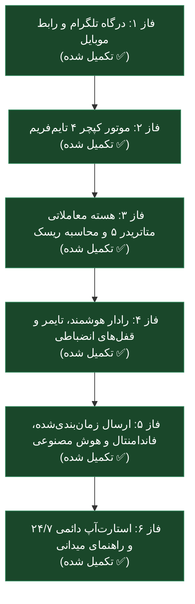

# 🗺️ نقشه راه و برنامه اجرایی جامع پروژه TradingGuard (HITL)

> **هدف سیستم**: ایجاد یک سپر انضباطی و اتوماسیون نیمه‌خودکار (Human-In-The-Loop) برای تریدری که شغل تمام‌وقت دارد و نمی‌تواند پای سیستم باشد؛ حذف ترس و تردید در ورود، حذف ترید انتقامی، ثبت اردر صرفاً از طریق لیمیت، و رعایت سفت‌وسخت سقف ریسک ۱۲ دلاری.

---

## 🧭 وضعیت کلان پروژه در یک نگاه

---

## 📊 ماتریس تفصیلی فازهای پروژه

| فاز | عنوان | وضعیت | خروجی‌های کلیدی |
| :--- | :--- | :---: | :--- |
| **فاز ۱** | **درگاه ارتباطی تلگرام و UI موبایل** | ✅ **تکمیل** | کلاینت پروکسی‌محور تلگرام، امنیت وایت‌لیست، کیبورد ۶دکمه‌ای پایدار، دیالوگ‌های تایید لغو دو مرحله‌ای |
| **فاز ۲** | **موتور کپچر پس‌زمینه TradingView** | ✅ **تکمیل** | معماری ۲تبی، کلیک مستقیم نوار ابزار (1D, 1H, 15M, 5M)، ارسال آلبوم پیوسته برای طلا و یورو، بدون افت ماکسیمایز |
| **فاز ۳** | **هسته معاملاتی MT5 و اعتبارسنجی ریاضی ریسک** | ✅ **تکمیل** | اتصال محلی پایتون به MT5، اعمال سقف ۱۲ دلاری ریسک با کسر اسپرد و کمیسیون، ثبت اردر لیمیت سخت با SL/TP، استعلام پوزیشن‌ها |
| **فاز ۴** | **رادار شتاب، گارد حوادث و قفل‌های انضباطی** | ✅ **تکمیل** | رادار مومنتوم ATR و اسپرد، یادآور انقضای اردر (TTL)، قفل ضرر روزانه ۲۴ دلار / ۲ ضرر متوالی، فیلتر سشن کاری (۱۱:۳۰ تا ۲۱:۰۰)، کول‌داون ۱۵/۲۵ دقیقه‌ای پس از خروج، گزارش زنده سود/زیان خروج |
| **فاز ۵** | **اتوماسیون زمان‌بندی‌شده، فاندامنتال و دستیار دیداری AI** | ✅ **تکمیل** | موتور بومی هوش مصنوعی Antigravity، تقویم فاندامنتال کاملاً رایگان (Faireconomy)، سنتز تکنیکال/فاندامنتال، سپر نوسان اخبار (News Guard)، ارسال خودکار سر ساعت |
| **فاز ۶** | **تست پایلوت دمو، پایداری ۲۴/۷ و مستندات میدانی** | ✅ **تکمیل** | استارت‌آپ خاموش ویندوز در پوشه Startup، مانیتور پالس سلامت دوره‌ای، دستور آنی `/ping`، تدوین راهنمای جامع میدانی (FIELD_GUIDE.md) |

---

## 🔍 جزئیات فازها و اقدامات گام‌به‌گام

### فاز ۱: درگاه ارتباطی تلگرام و UI موبایل (تکمیل شده ✅)
- [x] راه‌اندازی کلاینت اختصاصی تلگرام سازگار با پروکسی لوکال v2rayN روی پورت `10808`.
- [x] قفل امنیتی سفت‌وسخت بر اساس Chat ID تلگرام (مسدودسازی درخواست‌های متفرقه).
- [x] کیبورد Reply Keyboard ثابت در پایین صفحه گوشی با ۶ دکمه لمسی در دسترس.
- [x] دیالوگ ایمن دو مرحله‌ای برای لغو اردرها جهت جلوگیری از لمس تصادفی روی موبایل.

### فاز ۲: موتور کپچر ۴ تایم‌فریم تریدینگ‌ویو (تکمیل شده ✅)
- [x] معماری ۲ تب اختصاصی (تب ۱ = طلا، تب ۲ = یورو) برای رعایت محدودیت پلن Basic.
- [x] حذف وابستگی به زبان کیبورد ویندوز از طریق **کلیک مستقیم روی نوار ابزار**:
  - `1D`: موقعیت پیکسل `x=570`
  - `1H`: موقعیت پیکسل `x=465`
  - `15M`: موقعیت پیکسل `x=357`
  - `5M`: موقعیت پیکسل `x=322`
- [x] ارسال یکپارچه آلبوم ۴تایی در تلگرام با کپشن‌های راهنمای تحلیل.
- [x] حفظ ابعاد ماکسیمایز کروم و جلوگیری از تغییر اندازه پنجره مرورگر.

### فاز ۳: هسته معاملاتی متاتریدر ۵ و محاسبه دقیق ریسک (تکمیل شده ✅)
- [x] برقراری ارتباط نیتیو با ترمینال MT5 لایت‌فایننس با کتابخانه رسمی MetaTrader5.
- [x] فرمول اعتبارسنجی ریسک: $\text{Total Risk} = \text{Price Risk} + \text{Spread Cost} + \text{Commission Buffer} \le \$12.00$.
- [x] اعتبارسنجی هندسی جهت اردر (Buy Limit پایین‌تر از مارکت، SL پایین‌تر از ورود، TP بالاتر).
- [x] ثبت مکانیزم اردرهای لیمیت (`TRADE_ACTION_PENDING`) همراه با SL و TP سخت در سمت سرور بروکر (Set & Forget).
- [x] استعلام لحظه‌ای پوزیشن‌های باز و اردرهای معلق.

### فاز ۴: رادار هوشمند، تایمر و قفل‌های انضباطی (تکمیل شده ✅)
- [x] **رادار شتاب شارپ (Momentum Guard)**: پایش کندل‌های M1 هر ۳ ثانیه؛ لغو خودکار در صورت هجوم کندل با قدرت $> 2.0 \times \text{ATR}$ یا جهش اسپرد.
- [x] **یادآور زمان انقضای اردر (TTL Reminder)**: هشدار تلگرامی بعد از ۴۵ دقیقه بلاتکلیفی اردر با دکمه‌های «لغو اردر» و «حفظ اردر».
- [x] **قفل ضرر روزانه (Circuit Breaker)**: مسدودسازی خودکار ترید جدید در صورت رسیدن ضرر روزانه به ۲۴ دلار یا ثبت ۲ استاپ متوالی.
- [x] **فیلتر ساعت سشن معاملاتی**: مسدودسازی ثبت اردر خارج از ساعات نقدینگی فعال (۱۱:۳۰ تا ۲۱:۰۰ تهران) و ایام تعطیلی آخر هفته.
- [x] **قفل کول‌داون (Post-Trade Cooldown)**: قفل انضباطی ۱۵ دقیقه پس از تارگت و ۲۵ دقیقه پس از استاپ جهت آرامش ذهن و مهار هیجانات.
- [x] **گزارش لحظه‌ای بسته شدن پوزیشن**: تشخیص فوری خروج پوزیشن در متاتریدر و ارسال کارت سود/زیان دقیق به همراه کارمزدها در تلگرام.

### فاز ۵: اتوماسیون ارسال، فاندامنتال و دستیار دیداری AI (تکمیل شده ✅)
- [x] **موتور بومی هوش مصنوعی Antigravity (`hitl/ai_analyst.py`)**: اتصال بدون واسطه به موتور بومی `agy.exe` روی سیستم بدون نیاز به کلید API.
- [x] **موتور تقویم و داده‌های فاندامنتال رایگان (`hitl/macro_calendar.py`)**: دریافت خودکار رویدادهای قرمز (FOMC, CPI, NFP) از فیدهای عمومی، کش هوشمند ۲ ساعته، و تبدیل به افق زمانی تهران بدون هیچ هزینه مالی.
- [x] **تحلیل ترکیبی تکنیکال و فاندامنتال (سنتز ۴ بولت)**: تزریق همزمان تصاویر ۴تایم و اخبار مهم اقتصادی روز به Antigravity جهت بررسی ارتباط نوسانات، فشردگی و کاتالیزورهای کلان.
- [x] **سپر نوسانات پرریسک اخبار (News Proximity Guard)**: مسدودسازی ثبت اردر لیمیت جدید تا ۲۰ دقیقه قبل و ۵ دقیقه بعد از اخبار قرمز (High Impact) به دلیل جهش اسپرد.
- [x] **رادار هشدار خبر برای اردرهای فعال**: ارسال هشدار اختصاصی تلگرام همراه با دکمه لغو اردر ۱۵ دقیقه پیش از رهایش اخبار مهم دلاری.
- [x] **دستور استعلام `/news`**: مشاهده رویدادهای فاندامنتال ۲۴ ساعت آینده در هر لحظه روی موبایل.
- [x] **ارسال موازی و غیرمسدودکننده (Threaded)**: انجام تحلیل هوش مصنوعی در پس‌زمینه بدون کوچک‌ترین وقفه در عملکرد ربات تلگرام.
- [x] **ارسال خودکار سر ساعت (Hourly Scheduled Auto-Dispatch)**: پایش مداوم زمان و ارسال خودکار پکیج تحلیلی طلا در آغاز هر ساعت معاملاتی (دوشنبه تا جمعه ۱۱:۳۰ الی ۲۰:۳۰ تهران).

### فاز ۶: تست میدانی زنده و پایداری ۲۴/۷ (تکمیل شده ✅)
- [x] **تنظیم اسکریپت استارت‌آپ خاموش ویندوز**: ایجاد `start_silent.vbs` و قرار دادن در پوشه Startup ویندوز جهت اجرای خودکار پس از روشن شدن کامپیوتر بدون دخالت دست.
- [x] **اسکریپت توقف اضطراری (`stop_tradingguard.bat`)**: دستور تک‌کلیکی جهت متوقف‌سازی سریع سرویس در صورت نیاز.
- [x] **پالس سلامت دوره‌ای و دستور `/ping`**: ارسال گزارش سلامت، آپ‌تایم، اتصال متاتریدر و پروکسی هر ۶۰ دقیقه + پاسخ آنی به دستور `/ping`.
- [x] **تدوین مستندات عملیاتی جامع میدانی ([FIELD_GUIDE.md](file:///g:/Code/TradingGuard/FIELD_GUIDE.md))**: مرجع کامل دستورات، رفتار سشن‌ها، قوانین ریسک و گردش کار موبایل.

---

> [!IMPORTANT]
> **تصمیم استراتژیک کاربر**:
> بخش ژورنال‌نویسی و دیتابیس تحلیلی طبق دستور صریح شما از این پروژه کنار گذاشته شده است زیرا در پروژه‌ای مجزا و کامل‌تر به آن می‌پردازید. تمام تمرکز این سیستم بر روی **دریافت دیداری چارت، ورود بدون تردید، مراقبت از لیمیت‌ها و کنترل ریسک** معطوف است.
