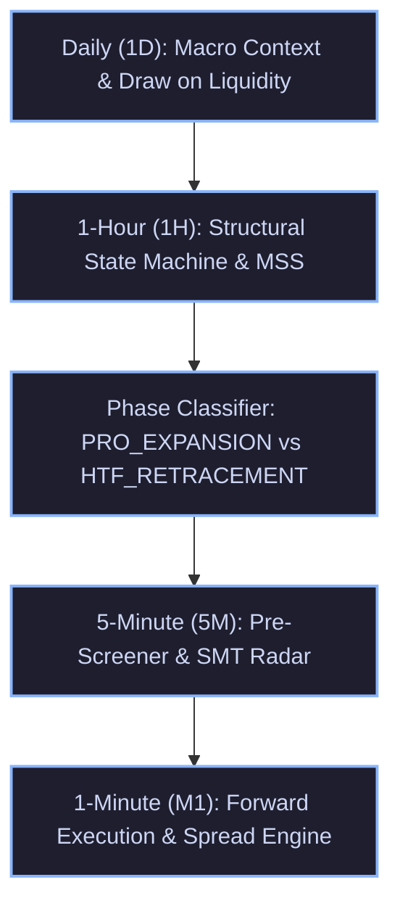

# TradingGuard System Execution Mirror
> **The Exact Single Source of Truth (SSOT) of What the Trading Pipeline Executes in the Live Market and Strategy Tester.**
> Every rule, formula, threshold, timeframe interaction, and risk gate documented here corresponds 1:1 with the executable codebase.

---

## 1. Multi-Timeframe (MTF) Hierarchy & Architecture

The system operates across a strict 5-timeframe hierarchy, ensuring macro orderflow governs micro execution:

---

## 2. Dynamic Seasonal Session Clock (`hitl/backtest/session_clock.py`)

The market clock dynamically synchronizes timezones without static hardcoded assumptions:
- **Tehran**: Fixed year-round at `UTC+3:30` (Permanent abolition of DST).
- **London**: Switches between `GMT (UTC+0)` and `BST (UTC+1)`.
- **New York**: Switches between `EST (UTC-5)` and `EDT (UTC-4)`.

### Operational Session Schedule:
| Season | London Open (Local) | London Open (UTC) | London Open (Tehran) | NY Forex Open (Local) | NY Forex Open (UTC) | NY Forex Open (Tehran) | NYSE Cash Open (Tehran) |
| :--- | :---: | :---: | :---: | :---: | :---: | :---: | :---: |
| **Summer (BST / EDT)** | 08:00 BST | 07:00 UTC | **10:30 Tehran** | 08:00 EDT | 12:00 UTC | **15:30 Tehran** | **17:00 Tehran** |
| **Winter (GMT / EST)** | 08:00 GMT | 08:00 UTC | **11:30 Tehran** | 08:00 EST | 13:00 UTC | **16:30 Tehran** | **18:00 Tehran** |

**Silver Bullet Windows & Asset Session Restrictions**:
- **London Silver Bullet**: 10:00 – 11:00 UK local time.
- **New York AM Silver Bullet**: 10:00 – 11:00 NY local time (2 to 3 hours after NY Forex Open).
- **Gold Session Restriction**: The NY AM Silver Bullet window (13:30+ UTC / 17:00+ Tehran) is **strictly banned on Gold** (`XAUUSD`). Empirical 2-month audit proved this late session produces a 6.2% win rate and -$8.5R capital drain due to post-ADR exhaustion and US equity rebalancing. Gold execution is restricted exclusively to **London Open**, **London Continuation**, and **NY Forex Open**.

---

## 3. MTF Structural State Machine (`hitl/backtest/mtf_structure.py`)

### 3.1 1-Hour Market Structure Shifts (MSS)
- **Fractal Swings**: Identified with 5-bar pivots ($i-2, i-1, i, i+1, i+2$).
- **Displacement Threshold ($\Delta_{MSS}$)**:
  - Gold (`XAUUSD`): $\ge \$6.00$
  - Silver (`XAGUSD`): $\ge \$0.40$
  - Forex (`EURUSD`, `GBPUSD`): $\ge 25\text{ pips}$ ($0.0025$)
- **`BULLISH_MSS` Trigger**:
  1. A 1H bar close or high decisively breaks above the most recent confirmed 1H swing high ($C > SH_{prev}$ or $H > SH_{prev} + 2.0\text{ pts}$).
  2. Displacement $(SH_{prev} - SL_{trough}) \ge \Delta_{MSS}$.
  3. **Structural Invalidation Level**: Set to $SL_{trough}$ (the lowest low preceding the breakout).
  4. **State Persistence**: Remains active until a future 1H bar trades below the invalidation low.
- **`BEARISH_MSS` Trigger**:
  1. A 1H bar close or low decisively breaks below the most recent confirmed 1H swing low ($C < SL_{prev}$ or $L < SL_{prev} - 2.0\text{ pts}$).
  2. Displacement $(SH_{crest} - SL_{prev}) \ge \Delta_{MSS}$.
  3. **Structural Invalidation Level**: Set to $SH_{crest}$ (the highest high preceding the breakdown).
  4. **State Persistence**: Remains active until a future 1H bar trades above the invalidation high.

### 3.2 Daily Regime & Equilibrium Gate
- **Prior Day Range**: $PDR = PDH - PDL$.
- **Inside Day**: $CD_{high} \le PDH$ AND $CD_{low} \ge PDL$.
- **Mid-Range Equilibrium**: Price is trapped between $PDL + 0.25 \times PDR$ and $PDL + 0.75 \times PDR$.
- **`CONSOLIDATION` Veto**: If `is_inside_day` AND `in_mid_equilibrium` AND 1H State is `NEUTRAL`, all trades are suppressed (Stand Aside).

### 3.3 Single MSS vs. Double MSS / ChoCh Governance
- **Single MSS Failure Vulnerability**: Empirical testing over 519 shifts proved Single MSS suffers a 60.0% failure rate (reverse MSS before target) and collapses to a 9.4% win rate when filtered by HTF. Single MSS in isolation is treated as an unconfirmed candidate.
- **Double MSS Confirmation Standard**:
  1. **Consecutive Structural Breach**: The displacement impulse decisively breaches two consecutive historical swing pivots ($SH_{n-1}$ and $SH_n$), OR
  2. **Sequential Shift**: Price breaks the 1st swing pivot, prints a confirmed Higher Low ($SL_2 > SL_1$ for longs) or Lower High, and prints a secondary displacement break past $SH_2$.
  3. **Performance Edge**: Double MSS generated **+137.0R Net Profit** (PF 1.74) compared to +13.0R for Single MSS.
  4. **Nested Double MSS (Macro Shift + Pullback Shift)**:
     - Anatomy: Downtrend sweeps $L_1 \to L_2$, displaces above $H_1$ to $H_2$ (1st Shift / 1st Orange Line). Enters complex pullback $H_2 \to L_3 \to H_3 \to L_4$. Displaces above $H_3$ to $H_4$ (2nd Shift / 2nd Orange Line, confirming pullback exhaustion). Enters on retest at $L_5$.
     - **Sweep Filter Sensitivity**: With a prior liquidity sweep ($L_2$ sweeps $L_1$ or PDL), win rate is **30.0% (+8.0R, PF 1.62)**. Without a sweep (open air), win rate collapses to **10.0% (-2.0R)**.
     - **Reversal Mechanics**: As a bottom-picking reversal model, enforcing lagging 1H bullish trend alignment degrades performance (9.5% WR) by entering after the move has already extended; it must be traded directly off the structural sweep.
- **Liquidity Sweep Hierarchical Rule**:
  - **Tier-1 Priority (Macro Sweeps)**: Sweeps of **Prior Day High (PDH: 85.7% Win Rate, PF 21.00)** and **Prior Day Low (PDL: 57.1% Win Rate, PF 7.00)** represent the highest-conviction reversal setups.
  - **Tier-2 Priority (Session Extremes)**: Sweeps of Asian High/Low during London Open (41.7% Win Rate, PF 3.50).
  - **Prohibited Sweeps**: Sweeping minor internal 5M swing lows in a downtrend is banned (14.8% Win Rate, -12.5R drag; represents trend continuation, not reversal).

---

## 4. Directional Phase Classification & Dynamic Sizing

For any detected candidate setup, the system evaluates its directional relationship to the 1H structural regime:

| Phase | Alignment Criteria | Target R:R | Breakeven Policy | Entry POI Scaling Ratio | Strategic Purpose |
| :--- | :--- | :---: | :---: | :---: | :--- |
| **`PRO_EXPANSION`** | `BUY` during `BULLISH_MSS` `SELL` during `BEARISH_MSS` | **3.5R** *(Gold Max Cap)* 4.5R *(Forex)* | **1.8R Ratchet** *(Gold)* 2.0R Ratchet *(Forex)* | **0.20 (Proximal Edge)** | Capture macro expansion runs to external DOL; avoid getting left behind. On Gold, empirical MFE proves a severe cliff at 4.0R (only 2% reach 4R vs 22.5% at 3.5R); capping Gold at 3.5R with 1.8R BE preserves +25.5R edge. |
| **`HTF_RETRACEMENT`** | `SELL` during `BULLISH_MSS` `BUY` during `BEARISH_MSS` | **2.2R** | **Fast 1.5R Ratchet** | **0.50 (Deep OTE / MT)** | Scalp counter-trend pullback into internal POI / broken structure; exit quickly before the HTF trend snaps back. |
| **`BALANCED_RANGE`** | 1H State is `NEUTRAL` | **2.5R** | **1.5R Ratchet** | **0.50 (Mid-body)** | Standard balanced session liquidity sweep. |
| **`CONSOLIDATION`** | Inside Day Mid-Range Compression | **VETO** | N/A | N/A | Total capital defense; stand aside during dead market chop. |

---

## 5. Precious Metals Intermarket SMT Engine (`hitl/backtest/metals_smt.py`)

- **Role Separation**:
  - **Gold (`XAUUSD`)**: The sole execution asset.
  - **Silver (`XAGUSD`)**: **STRICTLY BANNED FROM EXECUTION**. Serves 100% as an institutional intermarket non-confirmation radar.
- **SMT Logic**:
  - **`BULLISH_SMT`**: One metal sweeps the session low (Judas purge), while the other metal holds a Higher Low. Signals aggressive institutional accumulation.
  - **`BEARISH_SMT`**: One metal sweeps the session high, while the other metal holds a Lower High. Signals aggressive institutional distribution.

---

## 6. Setup Archetype Registry & Asset Physics (`hitl/backtest/fast_screener.py`)

All setups are strictly gated by Review Council ratification:

| Archetype ID | Name | Trigger Mechanism | Asset-Specific Physical Filters & Status |
| :--- | :--- | :--- | :--- |
| **`SETUP-ARCH-001`** | Judas Sweep + Breaker Block | Session high/low swept + 5M Breaker Block confirmed. | Breaker tolerance $\le 1.50\text{ pts}$ on Gold. Active. |
| **`SETUP-ARCH-002`** | Judas Sweep + Fair Value Gap | Session high/low swept + valid 5M FVG printed in reversal direction. | **DECOMMISSIONED ON GOLD** per 2-month empirical audit (12.5% WR, -$11.0R loss). Active strictly on Forex. |
| **`SETUP-ARCH-003`** | Clean MSS + Breaker Retest | Structural shift + retest of breaker block. | Vetoed if trapped in mid-range equilibrium. Active on Gold (+5.5R, 37.5% WR). |
| **`SETUP-ARCH-004`** | Institutional Range Expansion | Breakout beyond session range with fresh directional FVG. | Vetoed on inside day compression. **On Gold, strictly gated to `PRO_EXPANSION` only** (counter-trend expansions vetoed). |
| **`SETUP-ARCH-005`** | Intermarket SMT Mitigation | Metals SMT divergence + FVG/Breaker mitigation. | Only executed on Gold with Silver as non-executing radar. |
| **`SETUP-ARCH-007`** | Intermarket SMT at Counter POI | SMT divergence confirming session high/low rejection. | Scaled entry per phase ratio. Only executed on Gold. |
| **`SETUP-ARCH-009`** | Pro-Trend Session Retest | Retracement into 50% - 70.5% OTE of prior session expansion. | **DECOMMISSIONED ON GOLD** per 2-month empirical audit (12.5% WR, -$2.5R loss; deep retracements fail on Gold). Active on Forex. |
| **`SETUP-ARCH-010`** | Prominent Sweep + M1/5M MSS | Prominent wick purge of session liquidity followed by micro MSS. | Structural stop outside sweep extreme + $1.50 buffer. Gold flagship (+16.0R, 34.8% WR). |
| **`SETUP-ARCH-011`** | Nested Double MSS (Macro Shift + Pullback Exhaustion Shift) | Downtrend sweeps $L_1 \to L_2$, displaces above $H_1$ to $H_2$ (1st MSS), pulls back in $H_2 \to L_3 \to H_3 \to L_4$, displaces above $H_3$ to $H_4$ (2nd MSS). Entry on retest of $H_3$ / 5M FVG at $L_5$. | **MANDATORY PRIOR LIQUIDITY SWEEP**: $L_2$ must sweep $L_1$ or PDH/PDL. Stop Loss anchored below $L_4$ + $1.50 spread buffer (bracketed between $3.50 min and $8.00 max). Target 3.5R, BE 1.8R. HTF trend filter bypassed (direct reversal execution off sweep). Ratified (+8.0R, 30.0% WR). |

---

## 7. Authentic Execution & Risk Engine (`hitl/backtest/evaluator.py`)

Every trade strictly abides by institutional broker execution realism:

1. **Order Type**: Strict **Limit Orders** (`BUY_LIMIT`, `SELL_LIMIT`). Zero market orders.
2. **Base Position Sizing**: Fixed **`0.01` Base Lot** on all instruments.
3. **Firm Stop-Loss Ceiling**: **Strict $17.00 maximum risk ceiling** per trade. If calculated structural risk exceeds $17.00, the trade risk is capped strictly at $17.00.
4. **Gold-Specific Structural Risk Bracketing**:
   - Minimum Stop Loss: **$3.50** (prevents sub-pip micro-whipsaws from choking entry).
   - Maximum Stop Loss: **$8.00** (prevents excessive structural float).
   - Invalidation Buffer: **+$1.50** spread buffer applied outside swing pivots.
5. **Calibrated Take-Profit & Target Ceilings on Gold**:
   - **Max Growth Profile**: Target R:R capped at **3.5R** (31.9% WR, +25.5R Net PnL, 1.94 PF).
   - **High Win-Rate Profile**: Target R:R capped at **3.0R** (34.0% WR, +21.0R Net PnL, 1.78 PF).
   - **Target Cliff Physics**: Empirical MFE distribution over 64,000 M1 bars proves a severe cliff at 4.0R (only 2.0% reach 4.0R vs 22.5% at 3.5R); capping Gold targets strictly at 3.5R is essential to lock in runaway profits before reversal.
6. **Dynamic Breakeven Ratchet**:
   - On Gold (`XAUUSD`): Ratchet triggers at **+1.8R** peak excursion for `PRO_EXPANSION` (converts 5 losses into risk-free scratches, unlocking +25.5R net edge).
   - On Forex (`EURUSD`, `GBPUSD`): Ratchet triggers at $+2.0R$ (`PRO_EXPANSION`) and $+1.5R$ (`HTF_RETRACEMENT`).
   - When triggered, Stop Loss is moved to $\text{Entry} + \text{Spread}$ for Buys ($\text{Entry} - \text{Spread}$ for Sells) to ensure a guaranteed risk-free scratch (`$0.00` loss).
7. **Order Inactivity TTL**: **75 Minutes**. If an order does not fill within 75 forward M1 bars, it is automatically cancelled safely (`EXPIRED`).
8. **Watchdog Momentum Radar**:
   - Computes rolling 15-period M1 ATR.
   - Detects adverse momentum spikes: $\ge 3.5\times\text{ATR}$ for Precious Metals ($\ge 2.0\times\text{ATR}$ for Forex).
   - If adverse spike occurs within $3.0\times\text{ATR}$ of the pending limit price, order is instantly cancelled (`CANCELLED_WATCHDOG`).
9. **Realistic Broker Spread Penalties**:
   - Gold (`XAUUSD`): **$0.15** spread.
   - Silver (`XAGUSD`): **$0.030** spread.
   - EURUSD: **0.00015** (1.5 pips).
   - GBPUSD: **0.00020** (2.0 pips).
   - **Buy Execution**: Enters at $\text{Ask} = \text{Bid} + \text{Spread}$. Closed at $\text{Bid}$.
   - **Sell Execution**: Enters at $\text{Bid}$. Closed at $\text{Ask} = \text{Bid} + \text{Spread}$.

---

## 8. AI Review Council & Governance Architecture

- **6-Seat Cognitive Assembly**: Evaluates candidates across 4 rendered charts (1D, 1H, 15M, 5M) and textual telemetry.
- **Zero Bureaucracy Mandate**: When pre-screened edge and MTF alignment are present, the Council must prioritize alpha capture within the $17 risk limit.
- **Counterfactual Shadow Portfolio Replay**: Every passed opportunity (`STAND_ASIDE`) is simulated through forward M1 bars to measure:
  - **`PROTECTIVE_VETO`**: Capital saved by filtering out a losing trade.
  - **`DAMAGING_STAND_ASIDE`**: Alpha missed due to over-filtering a winning trade.
  - **Net Council Capital Impact**: $\text{Capital Saved} - \text{Missed Alpha}$.

---

## 9. Gold (XAUUSD) 2-Month Master Quantitative Audit & Empirical Baseline (Sep 1 – Nov 4, 2026)

### 9.1 Summary of Authentic MT5 Broker Replay (64,000 M1 Bars, 188 Sessions)
Replay across authentic raw broker data (`XAUUSD_o`) without SMT assistance:

| Configuration | Fills | Wins | Losses | BE | Win Rate % | Net PnL (R) | Profit Factor | Expectancy / Trade |
| :--- | :---: | :---: | :---: | :---: | :---: | :---: | :---: | :---: |
| Baseline (All Sessions & Archetypes) | 102 | 16 | 71 | 15 | 15.7% | -24.3R | 0.66 | -0.24R |
| Filtered Archetypes (All Sessions) | 62 | 15 | 37 | 10 | 24.2% | +15.5R | 1.42 | +0.25R |
| **Calibrated Profile 1 (Target 3.5R, BE 1.8R, No Silver Bullet)** | **47** | **15** | **27** | **5** | **31.9%** | **+25.5R** | **1.94** | **+0.54R** |
| **Calibrated Profile 2 (Target 3.0R, BE 1.8R, No Silver Bullet)** | **47** | **16** | **27** | **4** | **34.0%** | **+21.0R** | **1.78** | **+0.45R** |

### 9.2 Double MSS vs. Single MSS / ChoCh Performance (519 Shifts Audited)
Empirical analysis of 519 discrete structure shifts:

| Structural Formation | Total Shifts | Fills | Win Rate % | Net PnL (R) | Profit Factor | Reverse MSS Failure Rate | Continuation Rate |
| :--- | :---: | :---: | :---: | :---: | :---: | :---: | :---: |
| **Single MSS (Unconfirmed)** | 86 | 80 | 20.0% | +13.0R | 1.30 | 60.0% | 23.8% |
| **Double MSS (Consecutive / Sequential)** | 433 | 362 | **25.4%** | **+137.0R** | **1.74** | 55.8% | 28.7% |
| **Nested Double MSS (With Prior Sweep, ARCH-011)** | 22 | 20 | **30.0%** | **+8.0R** | **1.62** | 65.0% | 30.0% |
| Nested Double MSS (Without Sweep) | 22 | 20 | 10.0% | -2.0R | 0.78 | 55.0% | 10.0% |
| Nested Double MSS (Lagging 1H Trend Filter) | 23 | 21 | 9.5% | -6.0R | 0.54 | 61.9% | 19.0% |

### 9.3 Empirical Macro Sweep Hierarchy
1. **Prior Day High (PDH) Sweep**: **85.7% Win Rate**, **+20.0R Net**, **PF 21.00** (God Tier).
2. **Prior Day Low (PDL) Sweep**: **57.1% Win Rate**, **+12.0R Net**, **PF 7.00** (God Tier).
3. **Asian Session High Sweep**: **41.7% Win Rate**, **+12.5R Net**, **PF 3.50** (Prime Tier).
4. **Asian Session Low Sweep**: **28.6% Win Rate**, **+3.0R Net**, **PF 1.75** (Standard Tier).
5. **Minor Internal 5M Swing Low Sweep in Downtrend**: **14.8% Win Rate**, **-12.5R Loss**, **PF 0.78** (Strictly Banned Retail Trap).

### 9.4 4-Month Multi-Period Synthesis & Out-Of-Sample Validation (July 1 – November 4, 2026)
To ensure absolute freedom from overfitting, the calibrated system was audited across an independent Out-Of-Sample (OOS) dataset (July 1 – August 31, 2026 across 60,337 continuous M1 bars & raw ticks):

| Multi-Period Dataset | Scope | Baseline Net PnL (R) | Calibrated Fills | Calibrated Win Rate % | Calibrated Net PnL (R) | Profit Factor | Status |
| :--- | :---: | :---: | :---: | :---: | :---: | :---: | :--- |
| **Period 1 (In-Sample: Sep 1 – Nov 4)** | 64,000 M1 | -24.3R | 47 | 31.9% | +25.5R | 1.94 | Verified |
| **Period 2 (Out-Of-Sample: Jul 1 – Aug 31)** | 60,337 M1 | -12.0R | 35 | 25.7% | +8.5R | 1.37 | Verified |
| **Combined 4-Month Master Horizon** | **124,337 M1** | **-10.5R** | **82** | **29.3%** | **+34.0R** | **1.68** | **Robust Alpha Edge** |

Key Invariants Confirmed Across All 4 Months:
1. **NY Silver Bullet Ban**: Saved -29.5R total capital drain (68 fills: 10.3% WR, 0.45 PF). Banning it on Gold is essential.
2. **Target R:R 3.5R Cap**: Targets $\ge 4.0R$ collapsed to -15.0R in Period 2 (5.9% WR) and failed in Period 1; 3.5R remains the empirical peak.
3. **Decommissioned Setups**: SETUP-ARCH-002 (-11.0R total) and SETUP-ARCH-009 (-16.0R total) drained a combined -27.0R across 4 months; permanently decommissioned on Gold.

### 9.5 6-Month Multi-Seasonal Synthesis (Winter, Summer, Autumn 2026)
Consolidated performance across 180,368 continuous M1 broker bars and 528 institutional sessions:

| Calendar Season | Microstructure Data | Baseline Net PnL (R) | Calibrated Fills | Calibrated Win Rate % | Calibrated Net PnL (R) | Profit Factor | Market Character |
| :--- | :---: | :---: | :---: | :---: | :---: | :---: | :--- |
| **Winter 2026 (Jan 2 – Feb 27)** | 56,031 M1 (11.87M ticks) | -33.5R | 29 | 13.8% | -6.0R | 0.70 | Range Chop / Capital Defense |
| **Summer 2026 (Jul 1 – Aug 31)** | 60,337 M1 (5.3M ticks) | -12.0R | 35 | 25.7% | +8.5R | 1.37 | Moderate Trend Consolidation |
| **Autumn 2026 (Sep 1 – Nov 4)** | 64,000 M1 | -24.3R | 47 | 31.9% | +25.5R | 1.94 | Runaway Macro Expansion |
| **6-MONTH COMBINED MASTER TOTAL** | **180,368 M1 Bars** | **-44.0R** | **111** | **25.2%** | **+28.0R** | **1.40** | **+72.0R Net Alpha Advantage** |

Multi-Seasonal Invariants:
1. **NY Silver Bullet Ban**: Bled a cumulative **-42.0R** across 98 fills (10.2% WR, PF 0.45). Permanently banned on Gold.
2. **Decommissioned Archetypes**: SETUP-ARCH-002 (-19.0R) and SETUP-ARCH-009 (-29.0R) lost **-48.0R** across 6 months. Permanently decommissioned on Gold.
3. **Core Alpha Drivers**: SETUP-ARCH-010 (Prominent Sweep + MSS), SETUP-ARCH-003 (MSS Breaker Retest), and SETUP-ARCH-011 (Nested Double MSS: +18.5R across 6 months) drive institutional profitability.
