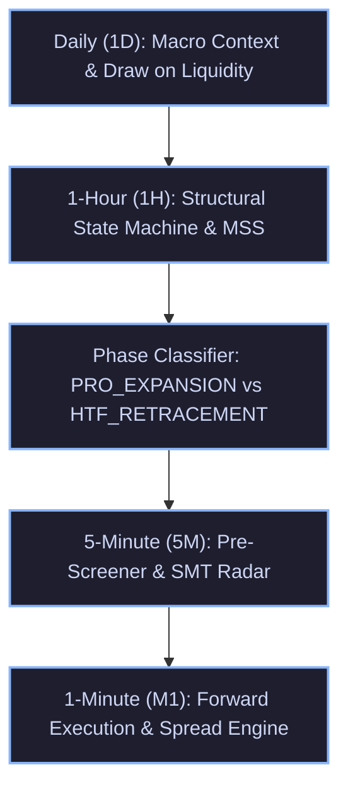

# TradingGuard System Execution Mirror
> **The Exact Single Source of Truth (SSOT) of What the Trading Pipeline Executes in the Live Market and Strategy Tester.**
> Every rule, formula, threshold, timeframe interaction, and risk gate documented here corresponds 1:1 with the executable codebase.

---

## 1. Multi-Timeframe (MTF) Hierarchy & Architecture

The system operates across a strict 5-timeframe hierarchy, ensuring macro orderflow governs micro execution:

---

## 2. Dynamic Seasonal Session Clock (`hitl/backtest/session_clock.py`)

The market clock dynamically synchronizes timezones without static hardcoded assumptions:
- **Tehran**: Fixed year-round at `UTC+3:30` (Permanent abolition of DST).
- **London**: Switches between `GMT (UTC+0)` and `BST (UTC+1)`.
- **New York**: Switches between `EST (UTC-5)` and `EDT (UTC-4)`.

### Operational Session Schedule:
| Season | London Open (Local) | London Open (UTC) | London Open (Tehran) | NY Forex Open (Local) | NY Forex Open (UTC) | NY Forex Open (Tehran) | NYSE Cash Open (Tehran) |
| :--- | :---: | :---: | :---: | :---: | :---: | :---: | :---: |
| **Summer (BST / EDT)** | 08:00 BST | 07:00 UTC | **10:30 Tehran** | 08:00 EDT | 12:00 UTC | **15:30 Tehran** | **17:00 Tehran** |
| **Winter (GMT / EST)** | 08:00 GMT | 08:00 UTC | **11:30 Tehran** | 08:00 EST | 13:00 UTC | **16:30 Tehran** | **18:00 Tehran** |

**Silver Bullet Windows**:
- **London Silver Bullet**: 10:00 – 11:00 UK local time.
- **New York AM Silver Bullet**: 10:00 – 11:00 NY local time (2 to 3 hours after NY Forex Open).

---

## 3. MTF Structural State Machine (`hitl/backtest/mtf_structure.py`)

### 3.1 1-Hour Market Structure Shifts (MSS)
- **Fractal Swings**: Identified with 5-bar pivots ($i-2, i-1, i, i+1, i+2$).
- **Displacement Threshold ($\Delta_{MSS}$)**:
  - Gold (`XAUUSD`): $\ge \$6.00$
  - Silver (`XAGUSD`): $\ge \$0.40$
  - Forex (`EURUSD`, `GBPUSD`): $\ge 25\text{ pips}$ ($0.0025$)
- **`BULLISH_MSS` Trigger**:
  1. A 1H bar close or high decisively breaks above the most recent confirmed 1H swing high ($C > SH_{prev}$ or $H > SH_{prev} + 2.0\text{ pts}$).
  2. Displacement $(SH_{prev} - SL_{trough}) \ge \Delta_{MSS}$.
  3. **Structural Invalidation Level**: Set to $SL_{trough}$ (the lowest low preceding the breakout).
  4. **State Persistence**: Remains active until a future 1H bar trades below the invalidation low.
- **`BEARISH_MSS` Trigger**:
  1. A 1H bar close or low decisively breaks below the most recent confirmed 1H swing low ($C < SL_{prev}$ or $L < SL_{prev} - 2.0\text{ pts}$).
  2. Displacement $(SH_{crest} - SL_{prev}) \ge \Delta_{MSS}$.
  3. **Structural Invalidation Level**: Set to $SH_{crest}$ (the highest high preceding the breakdown).
  4. **State Persistence**: Remains active until a future 1H bar trades above the invalidation high.

### 3.2 Daily Regime & Equilibrium Gate
- **Prior Day Range**: $PDR = PDH - PDL$.
- **Inside Day**: $CD_{high} \le PDH$ AND $CD_{low} \ge PDL$.
- **Mid-Range Equilibrium**: Price is trapped between $PDL + 0.25 \times PDR$ and $PDL + 0.75 \times PDR$.
- **`CONSOLIDATION` Veto**: If `is_inside_day` AND `in_mid_equilibrium` AND 1H State is `NEUTRAL`, all trades are suppressed (Stand Aside).

---

## 4. Directional Phase Classification & Dynamic Sizing

For any detected candidate setup, the system evaluates its directional relationship to the 1H structural regime:

| Phase | Alignment Criteria | Target R:R | Breakeven Policy | Entry POI Scaling Ratio | Strategic Purpose |
| :--- | :--- | :---: | :---: | :---: | :--- |
| **`PRO_EXPANSION`** | `BUY` during `BULLISH_MSS` `SELL` during `BEARISH_MSS` | **3.5R** *(Gold Max Cap)* 4.5R *(Forex)* | **2.0R Ratchet** | **0.20 (Proximal Edge)** | Capture macro expansion runs to external DOL; avoid getting left behind. On Gold, empirical MFE proves a severe cliff at 4.0R (only 2% reach 4R vs 22.5% at 3.5R); capping Gold at 3.5R preserves +10.0R edge. |
| **`HTF_RETRACEMENT`** | `SELL` during `BULLISH_MSS` `BUY` during `BEARISH_MSS` | **2.2R** | **Fast 1.5R Ratchet** | **0.50 (Deep OTE / MT)** | Scalp counter-trend pullback into internal POI / broken structure; exit quickly before the HTF trend snaps back. |
| **`BALANCED_RANGE`** | 1H State is `NEUTRAL` | **2.5R** | **1.5R Ratchet** | **0.50 (Mid-body)** | Standard balanced session liquidity sweep. |
| **`CONSOLIDATION`** | Inside Day Mid-Range Compression | **VETO** | N/A | N/A | Total capital defense; stand aside during dead market chop. |

---

## 5. Precious Metals Intermarket SMT Engine (`hitl/backtest/metals_smt.py`)

- **Role Separation**:
  - **Gold (`XAUUSD`)**: The sole execution asset.
  - **Silver (`XAGUSD`)**: **STRICTLY BANNED FROM EXECUTION**. Serves 100% as an institutional intermarket non-confirmation radar.
- **SMT Logic**:
  - **`BULLISH_SMT`**: One metal sweeps the session low (Judas purge), while the other metal holds a Higher Low. Signals aggressive institutional accumulation.
  - **`BEARISH_SMT`**: One metal sweeps the session high, while the other metal holds a Lower High. Signals aggressive institutional distribution.

---

## 6. Setup Archetype Registry & Asset Physics (`hitl/backtest/fast_screener.py`)

All setups are strictly gated by Review Council ratification:

| Archetype ID | Name | Trigger Mechanism | Asset-Specific Physical Filters |
| :--- | :--- | :--- | :--- |
| **`SETUP-ARCH-001`** | Judas Sweep + Breaker Block | Session high/low swept + 5M Breaker Block confirmed. | Breaker tolerance $\le 1.50\text{ pts}$ on Gold. |
| **`SETUP-ARCH-002`** | Judas Sweep + Fair Value Gap | Session high/low swept + valid 5M FVG printed in reversal direction. | Min FVG gap $\ge \$1.00$, Displacement candle body $\ge \$1.50$ on Gold. |
| **`SETUP-ARCH-003`** | Clean MSS + Breaker Retest | Structural shift + retest of breaker block. | Vetoed if trapped in mid-range equilibrium. |
| **`SETUP-ARCH-004`** | Institutional Range Expansion | Breakout beyond session range with fresh directional FVG. | Vetoed on inside day compression. |
| **`SETUP-ARCH-005`** | Intermarket SMT Mitigation | Metals SMT divergence + FVG/Breaker mitigation. | Only executed on Gold. |
| **`SETUP-ARCH-007`** | Intermarket SMT at Counter POI | SMT divergence confirming session high/low rejection. | Scaled entry per phase ratio. |
| **`SETUP-ARCH-009`** | Pro-Trend Session Retest | Retracement into 50% - 70.5% OTE of prior session expansion. | Prior session displacement $\ge \$12.00$ on Gold ($\ge 35\text{ pips}$ on FX). |
| **`SETUP-ARCH-010`** | Prominent Sweep + M1/5M MSS | Prominent wick purge of session liquidity followed by micro MSS. | Structural stop outside sweep extreme. |

---

## 7. Authentic Execution & Risk Engine (`hitl/backtest/evaluator.py`)

Every trade strictly abides by institutional broker execution realism:

1. **Order Type**: Strict **Limit Orders** (`BUY_LIMIT`, `SELL_LIMIT`). Zero market orders.
2. **Base Position Sizing**: Fixed **`0.01` Base Lot** on all instruments.
3. **Firm Stop-Loss Ceiling**: **Strict \$17.00 maximum risk ceiling** per trade. If calculated structural risk exceeds \$17.00, the trade risk is capped strictly at \$17.00.
4. **Order Inactivity TTL**: **75 Minutes**. If an order does not fill within 75 forward M1 bars, it is automatically cancelled safely (`EXPIRED`).
5. **Watchdog Momentum Radar**:
   - Computes rolling 15-period M1 ATR.
   - Detects adverse momentum spikes: $\ge 3.5\times\text{ATR}$ for Precious Metals ($\ge 2.0\times\text{ATR}$ for Forex).
   - If adverse spike occurs within $3.0\times\text{ATR}$ of the pending limit price, order is instantly cancelled (`CANCELLED_WATCHDOG`).
6. **Realistic Broker Spread Penalties**:
   - Gold (`XAUUSD`): **\$0.15** spread.
   - Silver (`XAGUSD`): **\$0.030** spread.
   - EURUSD: **0.00015** (1.5 pips).
   - GBPUSD: **0.00020** (2.0 pips).
   - **Buy Execution**: Enters at $\text{Ask} = \text{Bid} + \text{Spread}$. Closed at $\text{Bid}$.
   - **Sell Execution**: Enters at $\text{Bid}$. Closed at $\text{Ask} = \text{Bid} + \text{Spread}$.
7. **Dynamic Breakeven Ratchet**:
   - For `PRO_EXPANSION`: Ratchet triggers at $+2.0R$ peak excursion.
   - For `HTF_RETRACEMENT` & `BALANCED_RANGE`: Ratchet triggers at $+1.5R$ peak excursion.
   - When triggered, Stop Loss is moved to $\text{Entry} + \text{Spread}$ for Buys ($\text{Entry} - \text{Spread}$ for Sells) to ensure a guaranteed risk-free scratch (`$0.00` loss).

---

## 8. AI Review Council & Governance Architecture

- **6-Seat Cognitive Assembly**: Evaluates candidates across 4 rendered charts (1D, 1H, 15M, 5M) and textual telemetry.
- **Zero Bureaucracy Mandate**: When pre-screened edge and MTF alignment are present, the Council must prioritize alpha capture within the \$17 risk limit.
- **Counterfactual Shadow Portfolio Replay**: Every passed opportunity (`STAND_ASIDE`) is simulated through forward M1 bars to measure:
  - **`PROTECTIVE_VETO`**: Capital saved by filtering out a losing trade.
  - **`DAMAGING_STAND_ASIDE`**: Alpha missed due to over-filtering a winning trade.
  - **Net Council Capital Impact**: $\text{Capital Saved} - \text{Missed Alpha}$.
