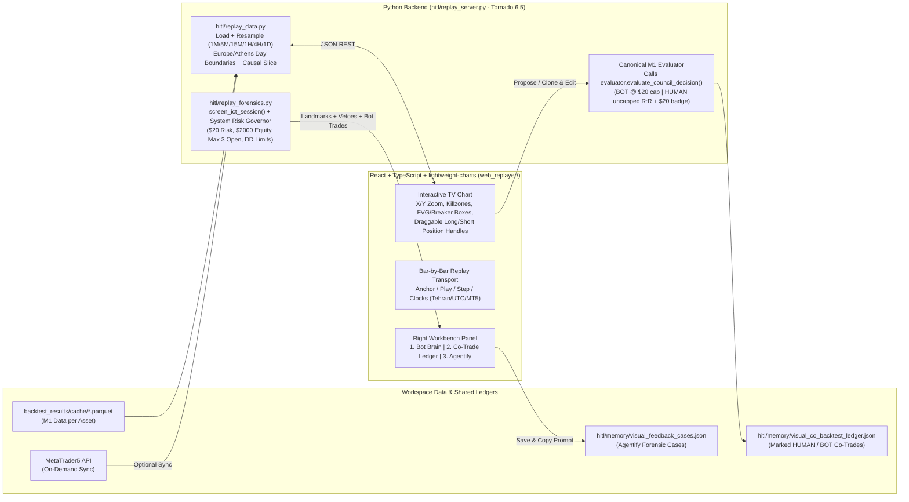

# Design Spec: TradingGuard Visual Co-Backtester & Agentify Alignment Workbench (v2)

**Date:** 2026-11-11  
**Size:** Project  
**Status:** Checked by Reviewer & Updated with Owner Decisions (Ready for Approval)  
**Selected Approach:** Approach 1 — Tornado Python API Server + React (Vite + TypeScript) + TradingView `lightweight-charts`

---

## 1. Intent & Why

TradingGuard's numerical backtests and v1 isolated single-day viewer (`hitl/backtest/export_visual_replay.py`) leave a wide blind spot between what the human trader sees on the chart and what the bot actually detects:
- Historical context across prior days (Yesterday -> Today continuity, Prior Day High/Low, higher-timeframe swing structure) breaks when each day is isolated into its own static HTML page.
- Switching symbols or jumping to arbitrary historical dates requires editing CLI arguments and re-compiling multi-megabyte static HTML files.
- Most critically, there is no way for the human trader and the bot to backtest **side-by-side** on the exact same unfolding candles—proposing missed setups, adjusting the bot's Entry/SL/TP levels, comparing realized R:R outcomes, and capturing structured forensic feedback explaining *why* the bot missed or vetoed a setup so Antigravity can align the Python strategy rules cleanly.

This project builds a local, interactive **Visual Co-Backtesting & Alignment Workbench** powered by real Python backtest/screener modules on the backend and TradingView-grade interactive charting on the frontend.

---

## 2. Goals, Non-Goals & Anti-Goals

### Goals
1. **Bot "Brain" Transparency**: Display continuous multi-day candlesticks overlaid with session Killzones, liquidity pools, sweeps, Market Structure Shifts (MSS), Breaker Blocks, FVGs, and exact per-bar SMC screener verdicts/vetoes.
2. **Co-Trading on Replay (Human + Bot)**:
   - Propose brand-new Long/Short trade setups directly on the chart during replay.
   - Clone and edit any Bot-detected trade (adjusting Entry, Stop Loss, Take Profit, or Breakeven rule) to test improvements.
   - Persist all Human proposed and edited trades into a **shared persistent ledger** (`hitl/memory/visual_co_backtest_ledger.json`) with explicit origin badges (`BOT` vs `HUMAN_PROPOSED` vs `HUMAN_EDITED_BOT`).
   - Simulate trades through TradingGuard's canonical M1 execution evaluator (`evaluate_council_decision`) and view side-by-side results (Win Rate, Net R, Profit Factor, Drawdown, MFE/MAE).
3. **Full Multi-Asset & Time Freedom**: Switch seamlessly across cached 2026 instruments (`XAUUSD_o`, `GBPUSD_o`, `NQ`, `SPX`, `YM`, `BTCUSD`) and scrub/jump freely across continuous multi-day/multi-week windows (plus on-demand MT5 sync for recent/missing bars).
4. **TradingView Navigation Physics & Multi-Timeframe Parity**:
   - Independent zoom/pan along **both the horizontal time axis and vertical price axis** (drag price axis to scale vertically, scroll/drag chart horizontally).
   - Instant switching across all timeframes used in TradingGuard: **`1M`, `5M`, `15M`, `1H`, `4H`, `1D`**, synchronized to the exact same replay timestamp with strict zero-lookahead.
5. **Agentify-Style Alignment Feedback Bridge**:
   - One-click capture of any replay moment, Human setup, or Bot trade edit together with a complete **Python Forensic Snapshot** (screener flags, session clock resolution, HTF structure state, exact veto message, and forward outcome).
   - Persists structured cases to `hitl/memory/visual_feedback_cases.json` and copies a ready-to-paste prompt/context bundle to clipboard for immediate handoff into Antigravity.

### Non-Goals
- **Live Broker Order Execution**: Never places live orders, modifies MT5 account positions, or writes `orders_schedule.csv` for production execution.
- **Auto-Mutating Production Code from UI**: UI tools never rewrite `hitl/backtest/fast_screener.py` in place. Production rule alignment happens deliberately via Antigravity after inspecting exported Agentify cases, keeping `docs/SYSTEM_EXECUTION_MIRROR.md` synchronized.
- **Quant Engine Integration (v2 Scope)**: Bot scanning in v2 is scoped strictly to the **SMC Engine (`screen_ict_session`)**; the Autonomous Quant Engine (`hitl/quant_engine/`) is explicitly deferred.

### Anti-Goals
- **Future Lookahead / Spoilers in Blind Replay**: Switching to `15M`, `1H`, `4H`, or `1D` mid-replay must NEVER reveal the final High/Low/Close of an unfinished bar; same-day Asian High/Low, Bot signals/exits, and Scorecard PnL beyond cursor `T` must remain masked until replay crosses them.
- **Data Overload in Browser**: Never push full 300,000+ M1 bar arrays across the wire at once; stream bounded visible/active windows dynamically.

---

## 3. Confirmed Owner Decisions & Settled Technical Rules

### Owner Decisions (Confirmed)
1. **Bot Engine Scope (`SMC` Only)**: `/api/bot-scan` wraps strictly `hitl/backtest/fast_screener.screen_ict_session(..., closed_bars_only=True)`.
   - `XAUUSD_o`, `GBPUSD_o`, and `NQ` operate as Bot-Active SMC instruments (`SPX` and `YM` preserve existing `fast_screener.py` behavior with an "Uncalibrated Index" badge; `BTCUSD` displays clearly as **"Manual / Human-Only Chart (SMC decommissioned on crypto)"**).
2. **System-Wide Risk & Drawdown Governance ($2,000 Account / $20 Max Trade Risk)**:
   - Account tier updated from legacy `$12` risk cap to **`$2,000.00` reference capital** and **`$20.00` per-trade risk limit** (matching `1.0%` at `$2,000`).
   - Bot scanning does **not** enforce arbitrary per-session single-trade caps; instead, it enforces **TradingGuard's real system-wide risk & drawdown limits** from `hitl/account_risk_manager.py` (`PROP_FIRM` profile defaults unless configured):
     * `max_open_trades = 3` concurrently open positions
     * `max_concurrent_risk_pct = 1.5%` (hard `2.0%` = `$40.00` total open risk at `$2,000`)
     * `max_daily_drawdown_pct = 4.0%` (`$80.00/day`, hard `5.0%` / `$100.00`)
     * `max_overall_drawdown_pct = 10.0%` (`$200.00` trailing HWM drawdown, hard `12.0%`)
     * Same-wave duplicate guard: suppresses consecutive M5 re-fires of the *identical* `(archetype_id, direction, entry_ref)` signal within an active order/cooldown window (30m), while allowing distinct/subsequent setups freely within system limits.
   - **Canonical Simulation Parameters (`evaluator.evaluate_council_decision`)**:
     * Updates the replay evaluator wrapper's `$12.0` hard cap override so Bot risk honors **`max_risk_usd = 20.0`** cleanly (while noting `hitl/config.py:30` and `evaluator.py:338` currently still hold `12.0` in production until aligned separately).
     * **Human Proposed / Edited Setups**: Simulate via exact canonical M1 bid/ask + SL-first mechanics with **`target_rr_cap = None`** and **uncapped true stop distance** (`(TP - Entry) / (Entry - SL)`) so wider `1H`/`4H` setups and `>3.5R` targets reflect true math. Displays a clear warning badge (`⚠️ Exceeds $20.00 risk cap at 0.01 lot`) whenever stop distance > `$20.00` without distorting the R:R ratio.
     * Forward simulation horizon extends through the end of the active simulation window (or optional `8h` intraday mode toggle, default full window so `1H`/`4H` swing trades don't prematurely expire at 8h).
3. **Shared Marked Co-Trade Ledger**:
   - All Human proposed and cloned/edited trades persist on disk in `hitl/memory/visual_co_backtest_ledger.json`, clearly marked by `origin`:
     * `"BOT"` (when snapshot-saved or surfaced from Bot Scan)
     * `"HUMAN_PROPOSED"` (drawn independently by Human)
     * `"HUMAN_EDITED_BOT"` (cloned from Bot trade with `parent_bot_ref` linking original Bot levels vs. edited Human levels)

### Settled Technical Rules (Builder Calls Marked Explicit)
* **`1D` / `4H` Broker Rollover Parity (`Europe/Athens`)**: Parquet caches store `Europe/Athens` (EET UTC+2 winter / EEST UTC+3 summer) wall-clock epochs. `ReplayDataManager` groups `1D` and `4H` candles strictly on **`Europe/Athens` broker-day boundaries** (NY 17:00 rollover) rather than `00:00 UTC` so `PDH`, `PDL`, `ADR`, and `is_inside_day` match MT5 `TIMEFRAME_D1` identically.
* **Multi-Clock X-Axis Toggle**: `lightweight-charts` displays X-axis ticks formatted dynamically in **Tehran (`UTC+3:30`, default)**, **UTC**, or **MT5 Server (`EET/EEST`)** via frontend time formatter toggle without mutating underlying epochs.
* **`clock_mode` Compatibility Around Unmodified `fast_screener.py`**: `replay_forensics.py` keeps raw MT5 server `'time'` and true UTC `'dt'` in bar dicts. In `true_tehran` mode (default), passes `true_tehran_dt.hour` and temporarily applies the **historical date-matched `Europe/Athens` UTC offset** around `screen_ict_session()` so summer London Open checks aren't skewed by winter offsets. In `live_legacy` diagnostic toggle, passes raw `tehran_hour_from_bar_time()` so you can directly reproduce live veto bugs (e.g., `2026-11-11 16:40` NY Open veto).
* **Anti-Spoiler Blind Replay Scope**: When `replay_mode` is active at cursor `T`, same-day Asian High/Low bounds accumulate incrementally over `[session_open .. min(T, asian_end)]`, Bot signals/vetoes/events filter to `<= T`, and open trades mask outcome/PnL/exit markers until `T >= exit_time`.
* **`smt_info` & Box Geometry**: Offline scans pass `smt_info=None` cleanly (avoiding cross-asset dependency blocks since `XAGUSD`/`EURUSD` parquet caches are absent). `replay_forensics.py` computes exact candle-span FVG (`top`, `bottom`, `t_start`, `t_end`) and Breaker zone coordinates in parallel with `screen_ict_session()` so real shaded boxes paint on the chart.
* **`SETUP-ARCH-013` Evaluation on `GBPUSD_o`**: Evaluated cleanly via `evaluate_council_decision` using its structural `dol_target` (`target_rr_cap=7.5` when `dol_target` present) in Bot Scan.

---

## 4. Technical Constraints & Cache Inventory

* **Python Runtime**: `tornado 6.5.4`, `websockets 16.0`, `pandas`, `pyarrow`, `MetaTrader5`. Zero new pip dependencies required.
* **Frontend Toolchain**: `Node v22.23.4`, `npm 11.7.0`. Isolated Vite + React + TypeScript app in `web_replayer/` using TradingView's `lightweight-charts`.
* **Verified M1 Parquet Caches (`backtest_results/cache/`)**:
  * `M1_XAUUSD_o_2026.parquet` (`2026-01-02` to `2026-11-11`, 305,293 bars)
  * `M1_GBPUSD_o_2026.parquet` (`2026-01-02` to `2026-11-04`, 313,791 bars; lacks `real_volume`)
  * `NQ_M1_EXTENDED_2026.parquet` (`2026-08-03` to `2026-11-06`, 96,352 bars)
  * `SPX_M1_2026.parquet` (`2026-08-03` to `2026-11-06`, 96,349 bars)
  * `YM_M1_2026.parquet` (`2026-08-03` to `2026-11-06`, 96,349 bars)
  * `BTCUSD_M1_2026.parquet` (`2026-08-31` to `2026-11-08`, 99,149 bars)

---

## 5. System Architecture & Data Flow

### Key Backend Endpoints (`hitl/replay_server.py`)
* `GET /api/catalog` -> Symbols, cached `[min_date, max_date]`, engine mode (`SMC` vs `MANUAL_ONLY`), timeframes `["1M","5M","15M","1H","4H","1D"]`, system risk limits (`account_size_usd: 2000`, `max_risk_usd: 20`).
* `GET /api/candles?symbol=...&tf=...&start=...&end=...&replay_to=...` -> Returns completed candles `<= replay_to` plus causally aggregated partial higher-timeframe forming bar up to `replay_to`.
* `GET /api/bot-scan?symbol=...&start=...&end=...&clock_mode=true_tehran&account_size=2000&max_risk=20` -> Walks M5 bars chronologically enforcing system-wide risk/drawdown limits (`AccountRiskManager` rules), returns Killzones, incremental Asian range curve, FVG/Breaker rectangles, per-bar Bot Brain diagnostics, and marked `BOT` trades.
* `POST /api/simulate-trade` -> Simulates any Human-proposed or Human-edited setup (`entry`, `sl`, `tp`, `direction`, `signal_time`, `be_rr`, `horizon`) via canonical M1 evaluator without R:R clipping + `$20` risk compliance flag.
* `GET/POST/PATCH/DELETE /api/co-trades` -> CRUD over persistent shared ledger (`hitl/memory/visual_co_backtest_ledger.json`) with origin tags (`BOT`, `HUMAN_PROPOSED`, `HUMAN_EDITED_BOT`).
* `GET/POST/DELETE /api/feedback` -> Saves complete **Agentify Forensic Snapshot** to `hitl/memory/visual_feedback_cases.json` and returns formatted clipboard-ready Markdown/JSON context for Antigravity.
* `POST /api/sync-mt5` -> Fetches latest MT5 M1 bars for active asset cleanly.

### Key React UI Components (`web_replayer/`)
* **Top Toolbar**: Symbol switcher, Date Range / "Jump to Date", 6 Timeframe buttons (`1M`, `5M`, `15M`, `1H`, `4H`, `1D`), Clock Toggle (`Tehran | UTC | MT5`), `true_tehran` vs `live_legacy` clock check toggle, Overlay toggles, Position Tool buttons (`+ Long`, `+ Short`).
* **Main Chart (`lightweight-charts`)**: Native TradingView X/Y scaling, custom series primitives for Killzone shading, incremental Asian High/Low lines, FVG/Breaker rectangles, Sweep labels, and interactive R:R Position boxes with draggable Entry/SL/TP price handles.
* **Right Workbench Panel**:
  1. **Bot Brain**: Live algorithmic verdict, internal flags (`session_hour`, `pierced_high/low`, `breaker`, `fvg`, `h1_state`, `phase`), exact veto text, clickable timeline events.
  2. **Shared Co-Trade Ledger & Scorecard**: Side-by-side performance (`BOT` vs `HUMAN_PROPOSED` vs `HUMAN_EDITED_BOT`) showing Net R, WR, PF, MFE/MAE, `$20` risk compliance badges, and `"Clone & Adjust"` action on Bot trades.
  3. **Agentify Feedback Inspector**: Captures active candle + Human setup/edit + Python screener telemetry + user rationale -> saves to `hitl/memory/visual_feedback_cases.json` and copies structured prompt block straight to clipboard.

---

## 6. Left to the Builder

* Exact React component composition, Tailwind/CSS layout polish, and `lightweight-charts` primitive rendering details.
* LRU caching mechanics for Parquet resampling and protective candle-count guards when zooming out across long multi-month `1M` ranges.
* Exact test suites covering Tornado handlers, causal partial-bar slicing, `Europe/Athens` daily boundaries, `$20` system-limit enforcement, and React smoke tests.
* **Note for Planning Step**: Decide whether live production `hitl/config.py:30` (`MAX_RISK_USD`) and `hitl/backtest/evaluator.py:338` (`$12.0` hard cap) should also be bumped to `$20.0` (with matching `SYSTEM_EXECUTION_MIRROR.md` sync) as a parallel task or kept scoped to explicit parameters passed by the workbench.
